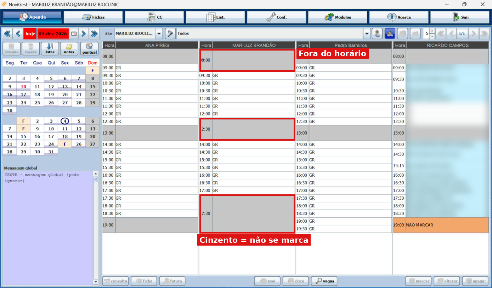
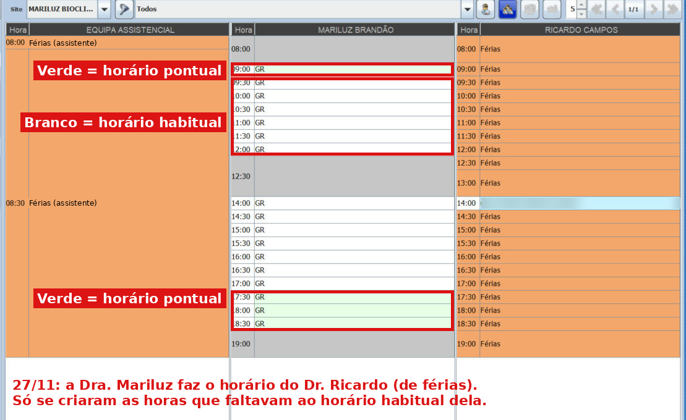
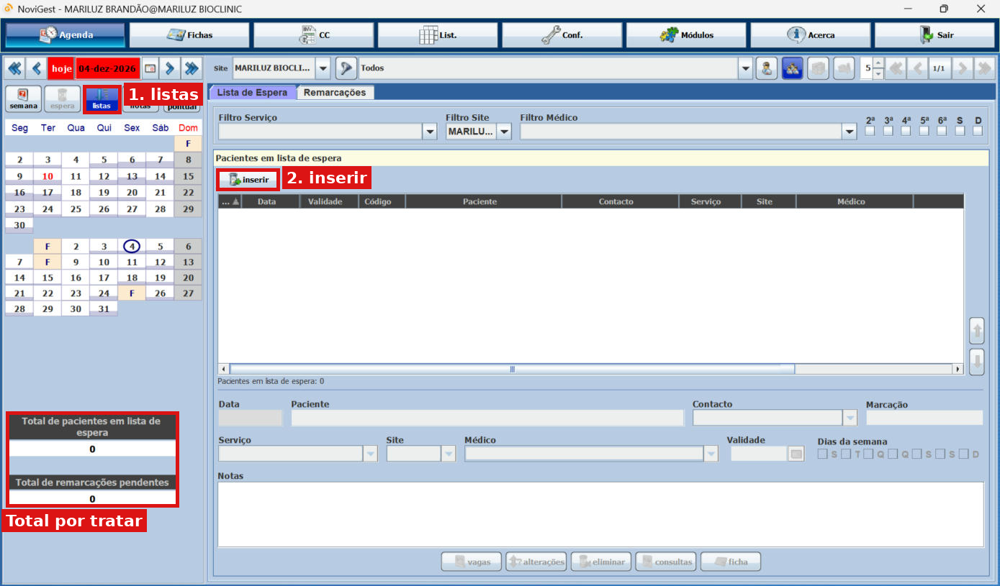
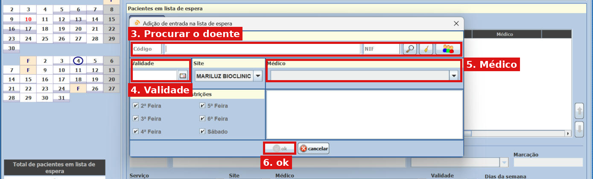

::: {.cabecalho}
{.logo fig-alt="Mariluz Bioclinic"}

[Manual da receção]{.titulo}
[Agenda Novigest · atualizado a ]{.sub}
:::

A receção é o primeiro contacto de cada doente com a Mariluz Bioclinic. Uma agenda bem
gerida é a base do cuidado que queremos prestar: o doente certo, à hora certa, com o médico certo.

::: {.callout-note}
## Para que serve este manual
É um guia rápido de consulta para a equipa de receção: o que se vê na agenda do Novigest e o
que fazer em cada caso. Horários, férias, ausências e dias de encerramento são registados pela
**gestão (Salomé)**. A equipa só tem de pedir por escrito e depois vê o resultado na agenda.
:::

## Horários dos médicos

**Dr. Ricardo Campos:** segunda e sexta, das 9h às 13h e das 14h às 19h, e sábados de 15 em 15 dias, das 9h às 13h.

**Dra. Mariluz Brandão:** segunda à tarde, terça, quinta e sexta (horas na tabela). Se for necessário,
está disponível para consultas à segunda de manhã, mas só depois de falar com ela.
Não trabalha ao sábado, exceto quando o Dr. Ricardo está de férias num sábado em que a clínica abre.

|                  | Seg                   | Ter                 | Qua     | Qui                 | Sex                     | Sáb                           |
|------------------|-----------------------|---------------------|---------|---------------------|-------------------------|-------------------------------|
| **Dra. Mariluz** | 14h–19h (manhã só falando com ela) | 9h–12h30 · 14h–19h  | Fechado | 9h–12h30 · 14h–19h  | 9h30–12h30 · 14h–17h30  | Só quando o Dr. Ricardo falta |
| **Dr. Ricardo**  | 9h–13h · 14h–19h      | —                   | Fechado | —                   | 9h–13h · 14h–19h        | 9h–13h                        |

A clínica fecha à quarta e ao domingo. Abre ao sábado de 15 em 15 dias, das 9h às 13h.
Os sábados em que está fechada aparecem com **F** no calendário.

::: {.callout-tip}
## Dois gabinetes ao mesmo tempo
O objetivo é ter **os dois gabinetes a funcionar ao mesmo tempo** nas horas em que estão
**duas assistentes presentes**. Nessas horas, sempre que possível, preencher as agendas dos
dois médicos em simultâneo.
:::

A Ana Pires e o Pedro Barreiros não têm horário fixo: só aparecem na agenda nos dias
combinados com a gestão ou quando já têm marcações. O Dr. Renato Conti já não trabalha na clínica.

## Como ler a agenda

| O que se vê | O que quer dizer | Marca-se? |
|---|---|---|
| [ ]{.cor .branco} Hora a **branco** ("GR") | Horário habitual do médico | Sim |
| [ ]{.cor .verde} Hora a **verde claro** | Horas extra só nesse dia (horário pontual) | Sim — nas férias do Dr. Ricardo, de preferência depois de preenchido o branco da Dra. Mariluz |
| [ ]{.cor .cinzento} Hora a **cinzento** | Fora do horário: antes de começar, almoço, depois de acabar | Não, salvo autorização (ver [Marcar fora do horário](#marcar-fora-do-horário)) |
| [ ]{.cor .laranja} **"Férias"** a laranja | Médico ausente nesse dia | Não |
| **F** no calendário | Clínica fechada | Não |
| Coluna **EQUIPA ASSISTENCIAL** | Alguém da equipa está ausente | Nunca se marca nesta coluna |

Se um médico **não tem coluna** num dia, não trabalha nesse dia. A coluna só aparece se lá
houver uma marcação antiga.

::: {.callout-important}
**Já não se escreve "NÃO MARCAR" nem "ENCERRADA" na agenda.** A agenda mostra sozinha quando se pode marcar.
:::

**Exemplo 1** — numa terça-feira, o Dr. Ricardo não aparece e o almoço da Dra. Mariluz está a cinzento.

{fig-alt="Agenda de uma terça-feira: o Dr. Ricardo não aparece e o almoço da Dra. Mariluz está a cinzento"}

**Exemplo 2** — numa sexta-feira, a Dra. Mariluz só tem branco das 9h30 às 12h30 e das 14h às 17h30.

{fig-alt="Agenda de uma sexta-feira: períodos a cinzento da Dra. Mariluz"}

### Horas a verde: férias do Dr. Ricardo

Quando o Dr. Ricardo está de férias, a Dra. Mariluz assume as horas dele que ficam disponíveis.
Essas horas aparecem **a verde** na coluna dela.

::: {.callout-important}
## De preferência, o horário habitual
Nas semanas de férias do Dr. Ricardo, as horas a verde usam-se em caso de necessidade, de preferência
depois de preenchidas as horas a branco (horário habitual) da Dra. Mariluz.
Isto aplica-se apenas às férias do Dr. Ricardo.
:::

**Exemplo 3** — a Dra. Mariluz faz o horário do Dr. Ricardo, que está de férias. As horas extra aparecem a verde.

{fig-alt="Horas pontuais a verde e horário habitual a branco na coluna da Dra. Mariluz"}

## Marcar fora do horário

Só se marca numa hora cinzenta quando o médico ou a gestão autorizam, por exemplo um doente às 19h.

1. Clicar na hora cinzenta, na coluna do médico.
2. Clicar em **marcar** (em baixo, à direita).
3. Escolher **"Efectuar marcação fora do horário habitual"** e confirmar. Depois marca-se como de costume.

{fig-alt="Marcar fora do horário habitual: hora cinzenta, marcar, escolher a opção"}

## Pedidos à gestão

Tudo o que muda os horários é feito pela gestão. Pede-se por escrito (email ou mensagem) à Salomé:

- **Férias ou ausência de um médico ou de uma assistente:** nome, data de início e de fim, motivo.
- **Médico muda o horário num dia** (entra mais tarde, sai mais cedo, almoço noutra hora) **ou vem num dia extra:** médico, dia e horas.
- **Clínica fechada ou aberta num dia fora do habitual:** o dia.

::: {.callout-warning}
Enquanto o pedido não aparecer na agenda, **não marcar doentes nesses dias ou horas**.
:::

Depois de registado, vê-se assim na agenda:

- **Férias de um médico:** "Férias" a laranja na coluna dele.
- **Férias de uma assistente:** aparece a coluna EQUIPA ASSISTENCIAL nesses dias, com o nome de quem está fora.
- **Horas que o médico deixa de fazer:** cinzento. **Horas extra:** verde.
- **Clínica fechada:** F no calendário.

{fig-alt="Agenda com as férias do médico a laranja"}

{fig-alt="Coluna EQUIPA ASSISTENCIAL com as férias de uma assistente"}

**Se já houver doentes marcados nos dias ou horas que saem, pô-los nas [Remarcações](#consultas-a-remarcar-remarcações).**
As marcações não desaparecem sozinhas.

## Lembretes para ligar a doentes: Lista de espera

Os lembretes do tipo "ligar para agendar limpeza" ou "passaram 6 meses, avisar" vão para a
**Lista de espera**. Deixam de ser marcações "A confirmar" às 9h na coluna de um médico.

**Para acrescentar um doente:**

1. Clicar em **listas** (em cima, à esquerda).
2. No separador **Lista de Espera**, clicar em **inserir**.
3. Procurar o doente pelo nome, código ou NIF.
4. Em **Validade**, pôr a data até à qual o doente deve ser marcado.
5. Escolher o **Médico**. Se o doente só puder em certos dias, tirar o visto aos outros em **Restrições**.
6. Clicar em **ok**.
7. Com a entrada selecionada na lista, escrever em **Notas** o que é preciso fazer, por exemplo "limpeza + controlo" ou "cheque-dentista de grávida".

{fig-alt="Lista de espera: botão listas, inserir e total por tratar"}

{fig-alt="Adição de entrada na lista de espera: doente, validade, médico, ok"}

**Quando o doente fica marcado:** selecioná-lo na lista, usar **vagas** para encontrar uma hora livre e,
depois de marcado, **eliminar** a entrada.

O número de doentes por tratar aparece à esquerda, em **"Total de pacientes em lista de espera"**.

## Consultas a remarcar: Remarcações

Quando um doente desmarca e é preciso voltar a marcar, ou quando uma ausência do médico obriga a mudar
consultas, o doente vai para as **Remarcações**.

1. Clicar em **listas** e abrir o separador **Remarcações**.
2. Clicar em **inserir** e escrever o código do doente (ou procurar pelo nome).
3. Em **Data**, pôr a data da consulta que é preciso mudar e escolher o **Médico**.
4. Na caixa grande, escrever o motivo e clicar em **ok**.
5. Ao selecionar a entrada, em baixo aparecem as **marcações futuras** do doente. É aí que se vê a consulta original.
6. Depois de remarcado, pôr o visto em **Tratado**.

{fig-alt="Separador Remarcações com o botão inserir e o total pendente"}

O número por tratar aparece à esquerda, em **"Total de remarcações pendentes"**.

## Resumo: o que fazer em cada caso

| Situação | O que fazer |
|---|---|
| Hora a cinzento, sem coluna ou "Férias" | Não marcar: o médico não está |
| Hora a branco | Marcar normalmente |
| Hora a verde (férias do Dr. Ricardo) | Marcar em caso de necessidade, de preferência depois de preenchidas as horas a branco (horário habitual) da Dra. Mariluz |
| Consulta autorizada fora de horas | Hora cinzenta → marcar → "fora do horário habitual" |
| Férias ou ausência de um médico ou de uma assistente | Pedir à gestão por escrito |
| Mudança de horário de um médico | Pedir à gestão por escrito |
| Clínica fecha ou abre fora do habitual | Pedir à gestão por escrito |
| Ligar a um doente para marcar | listas → Lista de Espera |
| Doente desmarcou ou é preciso remarcar | listas → Remarcações |
| Aviso interno com data | A definir |

::: {.callout-tip}
## Todos os dias
1. Abrir **listas** e tratar a Lista de espera e as Remarcações pendentes.
2. Devolver todas as chamadas.
3. Confirmar as consultas, segundo o procedimento de confirmação.
:::
