```{=html}
<header class="topo">
  
  <h1 class="titulo">Manual da receção</h1>
  <p class="lead">Uma agenda bem gerida é um dos pilares base do cuidado que queremos prestar.</p>
  <p class="meta">Agenda Novigest · atualizado a <span class="data"></span></p>
</header>
```

[]{#data-atualizacao .escondido}

::: {.nota}
**Para que serve.** Guia rápido para a receção: o que se vê na agenda do Novigest e o que fazer em
cada caso. Horários, férias, ausências e dias de encerramento são registados pela gestão (Salomé).
A equipa pede por escrito e depois vê o resultado na agenda.
:::

# 1. O dia a dia

## As regras da agenda

```{=html}
<ol class="regras">
  <li><span class="num">1</span><div><b>A agenda mostra sozinha quando se marca.</b><span>Já não se escreve "NÃO MARCAR" nem "ENCERRADA" na agenda.</span></div></li>
  <li><span class="num">2</span><div><b>Branco marca-se. Cinzento não.</b><span>O cinzento é fora do horário. Só se marca com autorização do médico ou da gestão.</span></div></li>
  <li><span class="num">3</span><div><b>Verde: depende do motivo.</b><span>Nas férias do Dr. Ricardo, em caso de necessidade, de preferência depois de preenchidas as horas a branco da Dra. Mariluz. Num dia de abertura alterado (ex.: quarta em vez de terça), marca-se normalmente.</span></div></li>
  <li><span class="num">4</span><div><b>Mudanças de horário pedem-se à gestão.</b><span>Férias, ausências e dias diferentes. Até aparecerem na agenda, não se marca nesses dias ou horas.</span></div></li>
  <li><span class="num">5</span><div><b>Na coluna EQUIPA ASSISTENCIAL nunca se marca.</b><span>Só aparece quando alguém da equipa está ausente.</span></div></li>
</ol>
```

## Todos os dias

```{=html}
<div class="tarefas">
  <div class="tarefa t-ler"><small>1</small>Abrir <b>listas</b> e tratar a Lista de espera e as Remarcações pendentes.</div>
  <div class="tarefa t-ligar"><small>2</small>Devolver todas as chamadas.</div>
  <div class="tarefa t-enviar"><small>3</small>Confirmar as consultas, segundo o <a href="#confirmação-de-consultas">procedimento de confirmação</a>.</div>
  <div class="tarefa t-ler"><small>4</small>Ver os <a href="#avisos-do-novigest">Avisos do Novigest</a> (Próteses e Stocks) e o calendário <a href="#avisos-internos-calendário-avisos-mbc">Avisos MBC</a>.</div>
  <div class="tarefa t-ler"><small>5</small>Ver os emails com o marcador <a href="#o-que-a-receção-faz">Faturas/Ação necessária</a> e registar no Novigest as faturas <b>Por registar</b>.</div>
  <div class="tarefa t-enviar"><small>6</small>Ao fim do dia, pedir <a href="#avaliações-no-google">avaliação no Google</a> aos doentes atendidos.</div>
</div>
```

# 2. Agenda

## Horários dos médicos

```{=html}
<div class="medicos">
  <div class="cartao">
    <h3>Dr. Ricardo Campos</h3>
    <p><b>Segunda e sexta:</b> 9h–13h · 14h–19h</p>
    <p><b>Sábado</b>, de 15 em 15 dias: 9h–13h</p>
  </div>
  <div class="cartao">
    <h3>Dra. Mariluz Brandão</h3>
    <p><b>Segunda:</b> 14h–19h <span class="suave">(de manhã só falando com ela)</span></p>
    <p><b>Terça e quinta:</b> 9h–12h30 · 14h–19h</p>
    <p><b>Sexta:</b> 9h30–12h30 · 14h–17h30</p>
    <p><b>Sábado:</b> só quando o Dr. Ricardo está de férias</p>
  </div>
</div>
```

A clínica fecha à quarta e ao domingo. Abre ao sábado de 15 em 15 dias, das 9h às 13h.
Os sábados em que está fechada aparecem com **F** no calendário.

::: {.destaque}
**Dois gabinetes ao mesmo tempo.** O objetivo é ter os dois gabinetes a funcionar ao mesmo tempo nas
horas em que estão duas assistentes presentes. Nessas horas, sempre que possível, preencher as agendas
dos dois médicos em simultâneo.
:::

A Ana Pires e o Pedro Barreiros não têm horário fixo: só aparecem na agenda nos dias combinados com a
gestão ou quando já têm marcações. O Dr. Renato Conti já não trabalha na clínica.

## Como ler a agenda

```{=html}
<div class="legenda">
  <div class="item"><span class="cor branco"></span><div><b>Branco ("GR")</b><span>Horário habitual do médico. Marca-se.</span></div></div>
  <div class="item"><span class="cor verde"></span><div><b>Verde claro</b><span>Horas extra só nesse dia. Como se marca depende do motivo (ver abaixo).</span></div></div>
  <div class="item"><span class="cor cinzento"></span><div><b>Cinzento</b><span>Fora do horário. Não se marca, salvo autorização.</span></div></div>
  <div class="item"><span class="cor laranja"></span><div><b>"Férias" a laranja</b><span>Médico ausente. Não se marca.</span></div></div>
  <div class="item"><span class="cor letra">F</span><div><b>F no calendário</b><span>Clínica fechada.</span></div></div>
  <div class="item"><span class="cor laranja"></span><div><b>Coluna EQUIPA ASSISTENCIAL</b><span>Alguém da equipa está ausente. Nunca se marca aqui.</span></div></div>
</div>
```

Se um médico não tem coluna num dia, não trabalha nesse dia. A coluna só aparece se lá houver uma
marcação antiga.

**Exemplo 1.** Numa terça-feira, o Dr. Ricardo não aparece e o almoço da Dra. Mariluz está a cinzento.

{fig-alt="Agenda de uma terça-feira: o Dr. Ricardo não aparece e o almoço da Dra. Mariluz está a cinzento"}

**Exemplo 2.** Numa sexta-feira, a Dra. Mariluz só tem branco das 9h30 às 12h30 e das 14h às 17h30.

{fig-alt="Agenda de uma sexta-feira: períodos a cinzento da Dra. Mariluz"}

### Horas a verde: depende do motivo

As horas a verde são horas que não fazem parte do horário habitual do médico. Aparecem por dois motivos,
e marca-se de forma diferente em cada um:

```{=html}
<div class="legenda">
  <div class="item"><span class="cor verde"></span><div><b>Férias do Dr. Ricardo</b><span>A Dra. Mariluz assume as horas dele que ficam disponíveis. Marcar em caso de necessidade, de preferência depois de preenchidas as horas a branco (horário habitual) dela.</span></div></div>
  <div class="item"><span class="cor verde"></span><div><b>Dia de abertura alterado</b><span>A clínica abre num dia em que normalmente fecha, em troca de outro (ex.: abre à quarta e fecha à terça). Marcar normalmente, como num dia habitual a branco.</span></div></div>
</div>
```


**Exemplo 3.** A Dra. Mariluz faz o horário do Dr. Ricardo, que está de férias. As horas extra aparecem a verde.

{fig-alt="Horas pontuais a verde e horário habitual a branco na coluna da Dra. Mariluz"}

## Marcar fora do horário

Só se marca numa hora cinzenta quando o médico ou a gestão autorizam, por exemplo um doente às 19h.

1. Clicar na hora cinzenta, na coluna do médico.
2. Clicar em **marcar** (em baixo, à direita).
3. Escolher **"Efectuar marcação fora do horário habitual"** e confirmar. Depois marca-se como de costume.

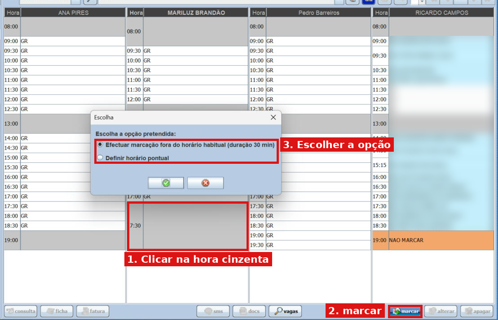{fig-alt="Marcar fora do horário habitual: hora cinzenta, marcar, escolher a opção"}

## Pedidos à gestão

Tudo o que muda os horários é feito pela gestão. Pede-se por escrito (email ou mensagem) à Salomé:

- **Férias ou ausência de um médico ou de uma assistente:** nome, data de início e de fim, motivo.
- **Médico muda o horário num dia** (entra mais tarde, sai mais cedo, almoço noutra hora) **ou vem num dia extra:** médico, dia e horas.
- **Clínica fechada ou aberta num dia fora do habitual:** o dia.

::: {.destaque}
Enquanto o pedido não aparecer na agenda, não marcar doentes nesses dias ou horas.
:::

Depois de registado, vê-se assim na agenda:

- **Férias de um médico:** "Férias" a laranja na coluna dele.
- **Férias de uma assistente:** aparece a coluna EQUIPA ASSISTENCIAL nesses dias, com o nome de quem está fora.
- **Horas que o médico deixa de fazer:** cinzento. **Horas extra:** verde.
- **Clínica fechada:** F no calendário.

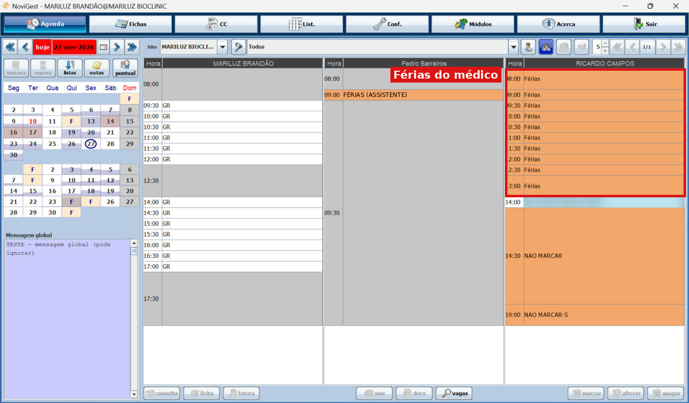{fig-alt="Agenda com as férias do médico a laranja"}

{fig-alt="Coluna EQUIPA ASSISTENCIAL com as férias de uma assistente"}

Se já houver doentes marcados nos dias ou horas que saem, pô-los nas
[Remarcações](#consultas-a-remarcar-remarcações). As marcações não desaparecem sozinhas.

# 3. Doentes

## Confirmação de consultas

O objetivo é ter a agenda cheia e saber quem vem. A receção tem duas tarefas: enviar as SMS
de confirmação, e ligar a quem não respondeu.

```{=html}
<ol class="regras">
  <li><span class="num">1</span><div><b>Não responder não é faltar.</b><span>Muita gente não responde e aparece na mesma. Nunca desmarcar alguém só porque não respondeu.</span></div></li>
  <li><span class="num">2</span><div><b>Uma vaga só se liberta se houver quem a ocupe.</b><span>Sem ninguém na Lista de espera, a consulta permanece marcada.</span></div></li>
  <li><span class="num">3</span><div><b>A lista de chamadas está no Novigest.</b><span>Ligar a todas as consultas que ainda estão em "A Confirmar".</span></div></li>
  <li><span class="num">4</span><div><b>Chamadas feitas até às 16h.</b><span>Assim o doente ainda tem tempo de responder até às 19h.</span></div></li>
  <li><span class="num">5</span><div><b>A confirmação sai na hora, de manhã.</b><span>Os doentes estão habituados a receber o dia e a hora da consulta, e isso só é possível no envio na hora. Não se agenda.</span></div></li>
</ol>

<h3 class="sub3">Tarefas de cada dia</h3>
<div class="dias">
  <div class="dia" data-d="1"><h4>Segunda</h4>
    <div class="tarefa t-ler"><small>1. Ao abrir</small>Ler as SMS que chegaram no fim de semana</div>
    <div class="tarefa t-enviar"><small>2. De manhã, enviar</small>SMS de confirmação para as <b>consultas de quinta</b></div>
    <div class="tarefa t-ligar"><small>3. Até às 16h, ligar a quem não confirmou</small><b>consultas de terça</b> em "A Confirmar"</div></div>
  <div class="dia" data-d="2"><h4>Terça</h4>
    <div class="tarefa t-enviar"><small>1. De manhã, enviar</small>SMS de confirmação para as <b>consultas de sexta</b></div>
    <div class="tarefa t-ligar"><small>2. Até às 16h, ligar a quem não confirmou</small><b>consultas de quinta</b> em "A Confirmar"</div></div>
  <div class="dia" data-d="4"><h4>Quinta</h4>
    <div class="tarefa t-ler"><small>1. Ao abrir</small>Ler as SMS que chegaram na quarta</div>
    <div class="tarefa t-enviar"><small>2. De manhã, enviar</small>SMS de confirmação para as <b>consultas de segunda e sábado</b></div>
    <div class="tarefa t-ligar"><small>3. Até às 16h, ligar a quem não confirmou</small><b>consultas de sexta</b> em "A Confirmar"</div></div>
  <div class="dia" data-d="5"><h4>Sexta</h4>
    <div class="tarefa t-enviar"><small>1. De manhã, enviar</small>SMS de confirmação para as <b>consultas de terça</b></div>
    <div class="tarefa t-ligar"><small>2. Até às 16h, ligar a quem não confirmou</small><b>consultas de segunda e sábado</b> em "A Confirmar"</div></div>
</div>
<p class="suave">Quarta e domingo: clínica fechada, não sai nenhuma SMS. Sábado: sem tarefas fixas.</p>

<h3 class="sub3">O que fazer em cada chamada</h3>
<div class="fluxo">
  <div class="passo">Ligar ao doente que está em "A Confirmar"</div>
  <div class="seta"></div>
  <div class="passo q">Atendeu?</div>
  <div class="seta"></div>
  <div class="ramos">
    <div class="ramo">
      <span class="pill sim">Sim</span>
      <div class="passo">Vem: mudar para <b>Confirmada</b>.<br>Não vem: desmarcar e propor outra data. Se não marcar já, vai para <b>Remarcações</b>.</div>
    </div>
    <div class="ramo">
      <span class="pill nao">Não</span>
      <div class="passo">Enviar logo a <b>SMS de aviso</b> (mensagem 2)</div>
      <div class="seta"></div>
      <div class="passo q">Respondeu até às 19h?</div>
      <div class="seta"></div>
      <div class="ramos interno">
        <div class="ramo"><span class="pill sim">Sim</span><div class="passo">Tratar como "Atendeu"</div></div>
        <div class="ramo"><span class="pill nao">Não</span><div class="passo">Há alguém na <b>Lista de espera</b>?<br>Sim: libertar a vaga e ligar a essa pessoa.<br>Não: a consulta <b>permanece marcada</b>.</div></div>
      </div>
    </div>
  </div>
</div>

<h3 class="sub3">Estados no Novigest</h3>
<div class="estados">
  <div><b>A Confirmar</b><span>A SMS de confirmação já saiu e o doente ainda não respondeu. Usar só para isto.</span></div>
  <div><b>Confirmada</b><span>O doente respondeu SIM, por SMS ou ao telefone.</span></div>
  <div><b>Remarcações</b><span>O doente não pode vir e ainda não escolheu nova data.</span></div>
</div>

<h3 class="sub3">As mensagens</h3>
<div class="msgs">
  <article class="msg">
    <header><h4>1. Confirmação</h4><span class="quem auto">Receção envia, de manhã</span></header>
    <div class="sms" id="m1">Olá [nome]. Tem consulta na Mariluz Bioclinic a [dia] às [hora]. Responda SIM para confirmar ou NÃO para desmarcar. Obrigada.</div>
    <button type="button" class="copiar" data-alvo="m1">Copiar mensagem</button>
    <p>Sai 3 a 4 dias antes da consulta (2 nas de sábado). Depois de enviar, pôr as consultas em "A Confirmar". Quem responde SIM passa a "Confirmada".</p>
  </article>
  <article class="msg">
    <header><h4>2. Aviso, quando não atende</h4><span class="quem voce">Envia a receção</span></header>
    <div class="sms" id="m2">Não conseguimos confirmar a sua consulta de [dia]. Se não recebermos resposta até às 19h de hoje, a vaga poderá ser atribuída a outro doente.</div>
    <button type="button" class="copiar" data-alvo="m2">Copiar mensagem</button>
    <p>Enviar só depois de ligar e o doente não atender.</p>
  </article>
</div>
```

::: {.nota}
**Consulta marcada em cima da hora?** Se a consulta é marcada depois de a SMS de confirmação já ter
saído, confirmá-la logo ao telefone ou ao balcão e pô-la em "Confirmada".
:::

## Lembretes para ligar a doentes: Lista de espera

Os lembretes do tipo "ligar para agendar limpeza" ou "passaram 6 meses, avisar" vão para a
**Lista de espera**. Deixam de ser marcações "A confirmar" às 9h na coluna de um médico.

**Para acrescentar um doente:**

1. Clicar em **listas** (em cima, à esquerda).
2. No separador **Lista de Espera**, clicar em **inserir**.
3. Procurar o doente pelo nome, código ou NIF.
4. Em **Validade**, pôr a data até à qual o doente deve ser marcado.
5. Escolher o **Médico**. Se o doente só puder em certos dias, tirar o visto aos outros em **Restrições**.
6. Clicar em **ok**.
7. Com a entrada selecionada na lista, escrever em **Notas** o que é preciso fazer, por exemplo "limpeza + controlo" ou "cheque-dentista de grávida".

{fig-alt="Lista de espera: botão listas, inserir e total por tratar"}

{fig-alt="Adição de entrada na lista de espera: doente, validade, médico, ok"}

**Quando o doente fica marcado:** selecioná-lo na lista, usar **vagas** para encontrar uma hora livre e,
depois de marcado, **eliminar** a entrada.

O número de doentes por tratar aparece à esquerda, em "Total de pacientes em lista de espera".

## Consultas a remarcar: Remarcações

Quando um doente desmarca e é preciso voltar a marcar, ou quando uma ausência do médico obriga a mudar
consultas, o doente vai para as **Remarcações**.

1. Clicar em **listas** e abrir o separador **Remarcações**.
2. Clicar em **inserir** e escrever o código do doente (ou procurar pelo nome).
3. Em **Data**, pôr a data da consulta que é preciso mudar e escolher o **Médico**.
4. Na caixa grande, escrever o motivo e clicar em **ok**.
5. Ao selecionar a entrada, em baixo aparecem as **marcações futuras** do doente. É aí que se vê a consulta original.
6. Depois de remarcado, pôr o visto em **Tratado**.

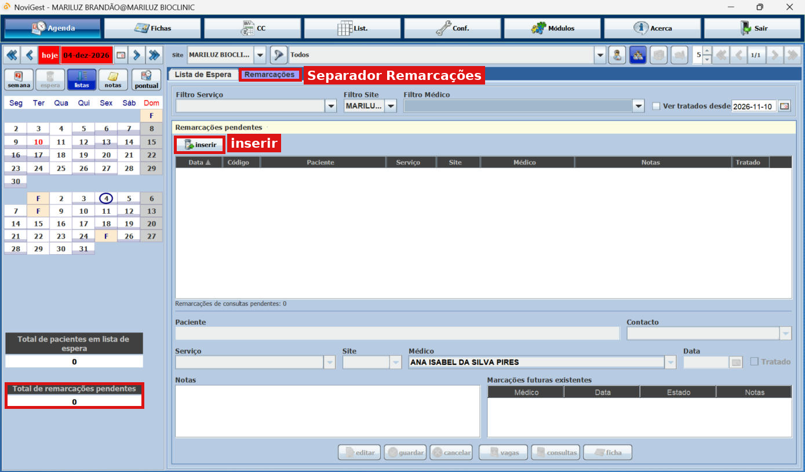{fig-alt="Separador Remarcações com o botão inserir e o total pendente"}

O número por tratar aparece à esquerda, em "Total de remarcações pendentes".

## Avaliações no Google

As avaliações ajudam outras pessoas a encontrar a clínica no Google. Há duas formas de o doente avaliar:
**já ao balcão**, com o cartão do código QR, ou **mais tarde**, pela SMS que a receção envia ao fim do dia.

```{=html}
<ol class="regras">
  <li><span class="num">1</span><div><b>A todos os doentes atendidos no dia.</b><span>Novos ou antigos, seja qual for a consulta. O que trava os pedidos repetidos é a regra 2.</span></div></li>
  <li><span class="num">2</span><div><b>No máximo uma vez por ano a cada doente.</b><span>Antes de enviar, ver as notas do doente no Novigest. Com "Avaliação pedida" há menos de um ano, não se envia. Com "Avaliação feita", não se volta a enviar.</span></div></li>
  <li><span class="num">3</span><div><b>Nunca oferecer nada em troca.</b><span>Nem descontos, nem brindes.</span></div></li>
</ol>

<h3 class="sub3">Ao balcão: aproveitar os tempos mortos</h3>
<p class="suave">Enquanto se processa o pagamento, se imprime a fatura ou se marca a próxima consulta, o doente está à espera com o telemóvel na mão. É o melhor momento para pedir a avaliação.</p>
<div class="tarefas">
  <div class="tarefa t-ler"><small>1</small>Ver no Novigest se o doente tem <b>"Avaliação feita"</b>, ou <b>"Avaliação pedida"</b> há menos de um ano. Se tiver, não dizer nada.</div>
  <div class="tarefa t-ligar"><small>2. Dizer ao doente, apontando para os cartões</small>"A sua opinião é muito importante para nós e ajuda outras pessoas a encontrarem-nos. Se quiser, pode avaliar-nos já no Google, com este código. Se preferir, hoje ainda lhe enviamos uma SMS com o link."</div>
  <div class="tarefa t-ler"><small>3</small>Se o doente <b>avaliou ao balcão</b>: pôr logo a nota <b>"Avaliação feita — [data]"</b> no Novigest. Não se envia SMS.<br>Se <b>não avaliou</b>: fica para a SMS do fim do dia.</div>
</div>
<p class="suave">Os cartões ficam num suporte no balcão, virados para o doente. Quem quiser pode levar um. O doente avalia sempre no próprio telemóvel, nunca num aparelho da clínica. Não ficar à espera de que o doente avalie à frente da receção.</p>

<h3 class="sub3">Como fazer, ao fim do dia</h3>
<div class="tarefas">
  <div class="tarefa t-ler"><small>1</small>Ver na agenda do dia <b>todos os doentes atendidos</b>.</div>
  <div class="tarefa t-ler"><small>2</small>No Novigest, ver as notas do doente. Se tiver <b>"Avaliação feita"</b>, ou <b>"Avaliação pedida"</b> há menos de um ano, não enviar.</div>
  <div class="tarefa t-enviar"><small>3</small>Enviar a mensagem pela plataforma de comunicações.</div>
  <div class="tarefa t-ler"><small>4</small>No Novigest, deixar a nota <b>"Avaliação pedida — [data]"</b> no doente.</div>
</div>

<h3 class="sub3">Uma vez por semana, à sexta</h3>
<div class="tarefas">
  <div class="tarefa t-ler"><small>1</small>Abrir as avaliações da clínica no Google e ver as que chegaram nessa semana.</div>
  <div class="tarefa t-ler"><small>2</small>Se o nome de quem avaliou corresponder a um doente a quem se pediu avaliação, mudar a nota no Novigest para <b>"Avaliação feita — [data]"</b>.</div>
</div>
<p class="suave">Nem sempre se consegue saber quem avaliou: o nome no Google pode ser diferente do nome do doente, ou aparecer só com iniciais. Na dúvida, a nota fica como "Avaliação pedida".</p>

<h3 class="sub3">A mensagem</h3>
<div class="msgs">
  <article class="msg">
    <header><h4>Pedido de avaliação</h4><span class="quem voce">Envia a receção</span></header>
    <div class="sms" id="m3">Olá [nome]. Obrigada por ter escolhido a Mariluz Bioclinic. A sua opinião ajuda outras pessoas a encontrar-nos. Por favor, deixe a sua avaliação no Google aqui: https://g.page/r/CTza7TufpYbtEBE/review</div>
    <button type="button" class="copiar" data-alvo="m3">Copiar mensagem</button>
    <p>Trocar [nome] pelo nome do doente antes de enviar.</p>
  </article>
</div>
```

::: {.nota}
**Apareceu uma avaliação negativa?** Não responder. Avisar a gestão (Salomé), que responde em nome da
clínica.
:::

# 4. Avisos, material e próteses

## Avisos internos: calendário Avisos MBC

Os avisos internos com data vão para o calendário **Avisos MBC**, no Google Calendar. Não se usam
notas na agenda do Novigest nem a mensagem global.

- **Com hora:** técnicos, entregas, reuniões, visitas.
- **De dia inteiro:** prazos, pagamentos, encomendas, entregas sem hora marcada.

**Para criar um aviso:**

1. Abrir o Google Calendar e clicar no dia e na hora do aviso.
2. Escrever um **título** curto e claro, por exemplo "Técnico do ar condicionado" ou "Pagar laboratório".
3. Confirmar o **dia e a hora** e clicar em **Mais opções**.

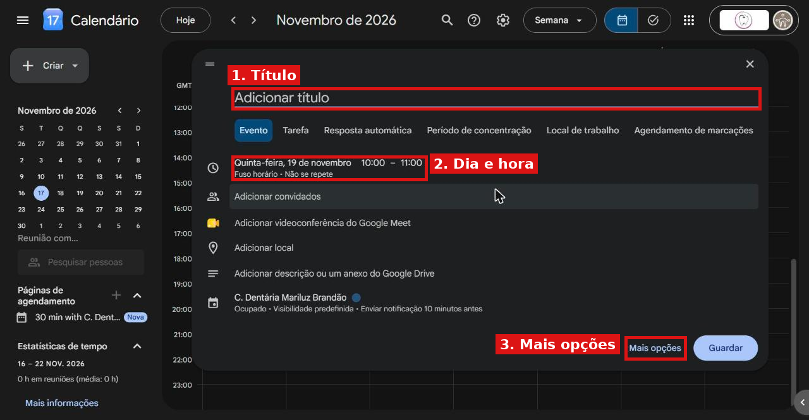{fig-alt="Criação rápida do evento: título, dia e hora, Mais opções"}

4. No calendário, escolher **Avisos MBC**.

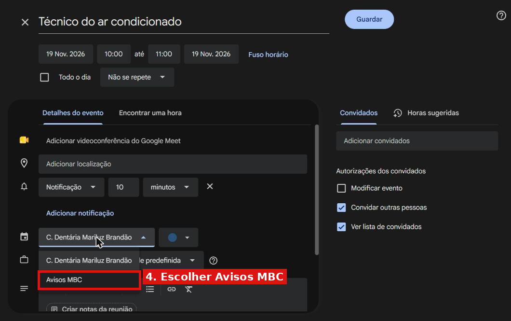{fig-alt="Escolha do calendário Avisos MBC"}

5. Se o aviso não tiver hora, marcar **Todo o dia**. Se for preciso, acrescentar uma nota na descrição, por exemplo um contacto ou um valor.
6. Clicar em **Guardar**.

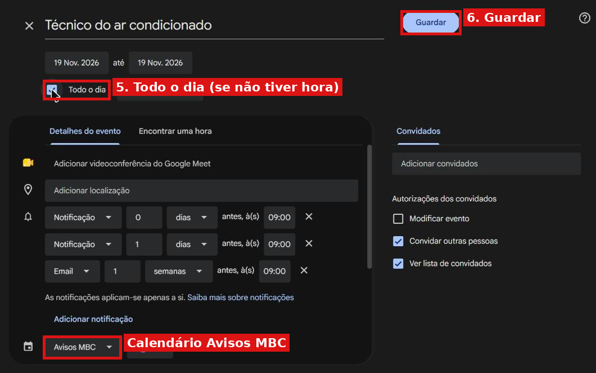{fig-alt="Evento de dia inteiro no calendário Avisos MBC e botão Guardar"}

::: {.destaque}
**Avisos para quinta ou segunda:** o aviso de "1 dia antes" chega à quarta ou ao domingo, com a clínica
fechada. Nesses casos, acrescentar no próprio evento uma notificação de **2 dias antes**.
:::

### Configurar as notificações (cada pessoa, uma vez)

As notificações são de cada pessoa: quem cria o calendário não as pode ligar pelas outras. Cada
pessoa da equipa faz isto uma vez, no computador e no telemóvel:

1. **Aceitar a partilha** do calendário Avisos MBC, para que apareça na lista de calendários.
2. Abrir as **definições do calendário Avisos MBC** (os três pontos ao lado do nome → *Definições e partilha*).
3. Em **Notificações de eventos**, pôr: *Notificação 1 dia* e *Notificação 30 minutos*.
4. Em **Notificações de eventos para todo o dia**, pôr: *Notificação 1 dia antes, às 09:00*, *Notificação 0 dias antes, às 09:00* e *Email 1 semana antes, às 09:00*.
5. **Ligar as notificações** da app Google Calendar no telemóvel e as do browser no computador.

## Avisos do Novigest

No Novigest há um ecrã **Avisos** que junta, num só sítio, o que está pendente: próteses, stocks,
orçamentos, consultas por fechar, remarcações, aniversários. Os avisos são gerados pelo próprio Novigest a
partir do que está registado: **só aparecem se as próteses e o material forem registados** (ver abaixo).

Os separadores a vermelho têm itens por tratar. Duplo clique numa linha abre esse item.

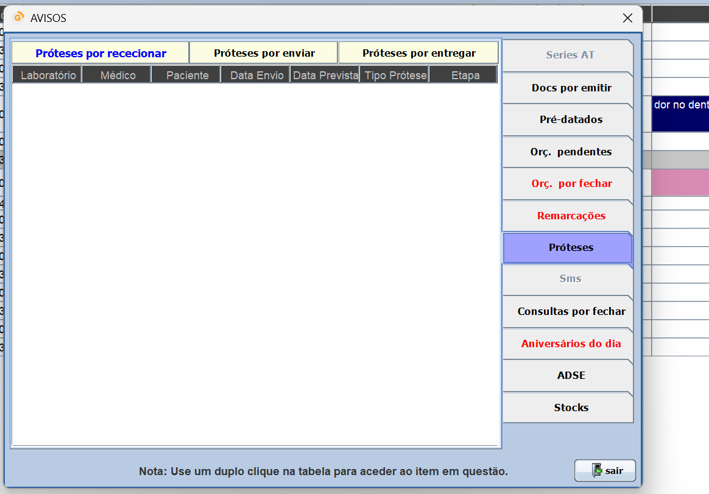{fig-alt="Ecrã Avisos do Novigest, separador Próteses"}

## Material: Stocks

O stock serve para saber o que há na clínica e o que está a acabar, sem ter de ir ao armário contar. Só
funciona se **tudo o que entra e tudo o que sai** for registado.

```{=html}
<div class="legenda">
  <div class="item"><span class="cor letra">+</span><div><b>Entrada</b><span>Chegou material do fornecedor.</span></div></div>
  <div class="item"><span class="cor letra">−</span><div><b>Saída</b><span>Abriu-se ou gastou-se uma embalagem.</span></div></div>
  <div class="item"><span class="cor letra">?</span><div><b>Pedido</b><span>Está a acabar: pedir à gestão para encomendar.</span></div></div>
</div>
```

Tudo se faz em **Módulos → Stocks**.

### Ver o que há em stock

Em **Existências** aparece cada produto com a quantidade que existe. Para encontrar um produto, escrever o
nome em **Produto**. As cores mostram o que precisa de atenção:

| Cor | Quer dizer |
|---|---|
| Vermelho | Stock negativo: saiu mais do que entrou (há um registo em falta) |
| Amarelo | Abaixo do mínimo: é preciso encomendar |
| Azul | Abaixo do ideal: encomendar na próxima encomenda |
| Laranja / roxo | Validade a terminar |

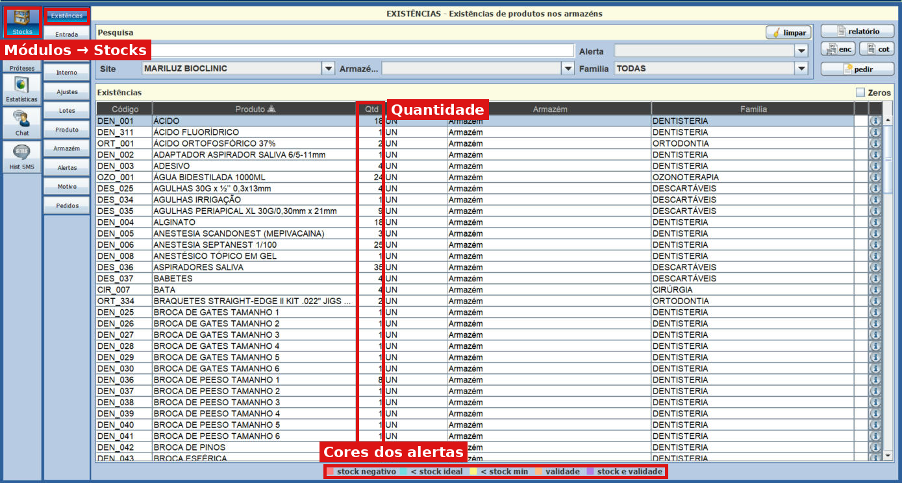{fig-alt="Existências: quantidade de cada produto e cores dos alertas"}

### Quando chega material: Entrada

1. Em **Entrada**, clicar em **criar** (em baixo).
2. Escolher o **Fornecedor** (o que vem na fatura ou guia).
3. Em **Armazém**, escolher **Armazém**.
4. Clicar em **inserir**, escolher o produto e escrever a quantidade e o valor da fatura. Repetir para cada produto.
5. Clicar em **confirmar**.

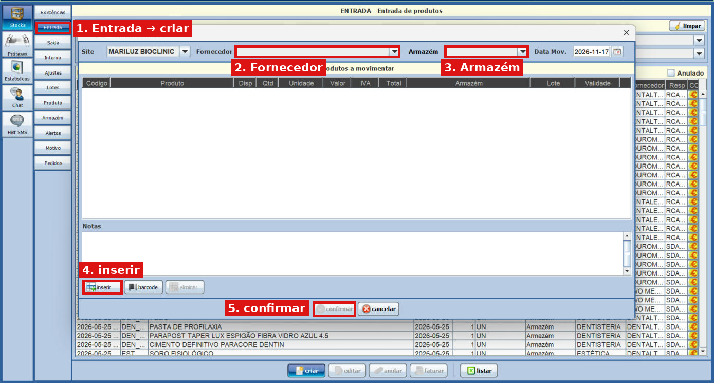{fig-alt="Movimentos de entrada: fornecedor, armazém, inserir, confirmar"}

### Quando se gasta material: Saída

Regista-se uma saída **sempre que se abre uma embalagem nova** (ou se deita fora um produto estragado ou fora
de validade). Não é preciso registar cada uso numa consulta.

1. Em **Saída**, clicar em **criar** (em baixo).
2. Clicar em **inserir** e escolher o produto.
3. Confirmar a **Qtd** (normalmente 1).
4. Escolher o **Motivo** (obrigatório).
5. Clicar em **confirmar**.

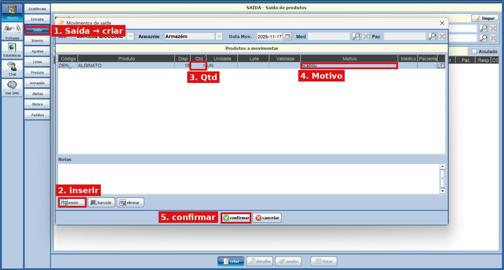{fig-alt="Movimentos de saída: inserir, quantidade, motivo, confirmar"}

| Motivo | Quando usar |
|---|---|
| Acabou | Abriu-se uma embalagem nova porque a anterior acabou |
| Tratamento / Consulta | Material gasto num doente em concreto |
| Danificado | Partiu-se ou estragou-se |
| Validade | Deitado fora por estar fora de validade |
| Devolução | Devolvido ao fornecedor |
| Outro | Qualquer outro caso (explicar em Notas) |

### Quando está a acabar: pedir à gestão

1. Em **Pedidos**, abrir **Requerer**.
2. Em **Armazém**, escolher **Armazém**.
3. Clicar em **inserir**, escolher o produto e a quantidade.
4. Clicar em **enviar**. O pedido fica registado para a gestão encomendar.

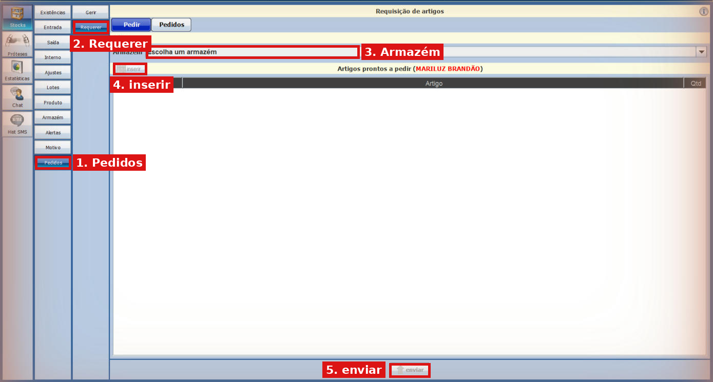{fig-alt="Requisição de artigos: pedidos, requerer, armazém, inserir, enviar"}

### Ver os alertas

Os produtos abaixo do mínimo aparecem também em **Avisos → Stocks**, separador **Alertas**. Os mínimos de
cada produto são definidos pela gestão.

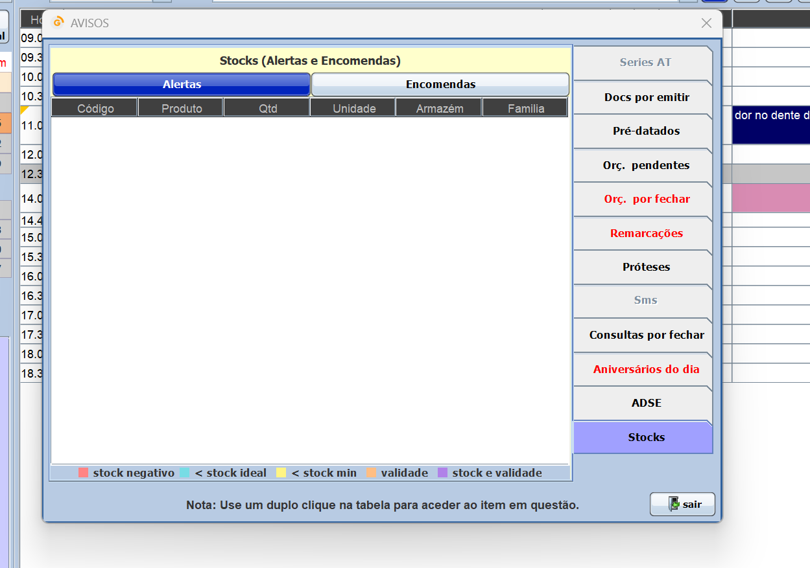{fig-alt="Avisos do Novigest, separador Stocks com os alertas"}

## Próteses e trabalhos de laboratório

O módulo de próteses serve para seguir cada trabalho de laboratório (coroas, aparelhos, goteiras, etc.)
desde que sai da clínica até ser entregue ao doente, sem depender da memória ou de papéis.

Em **Módulos → Próteses**, os trabalhos aparecem organizados pelo sítio onde estão:

| Grupo | Separador | Quer dizer |
|---|---|---|
| **No laboratório** | Pendentes em atraso | Passou a data prevista e ainda não voltou: ligar ao laboratório |
| | Outras pendentes | Está no laboratório, dentro do prazo |
| **Na clínica** | Para enviar | Já foi registado mas ainda não saiu para o laboratório |
| | Para prova ou entrega | Voltou do laboratório: marcar o doente |
| **Fechadas** | Entregues / Canceladas | Concluídas |

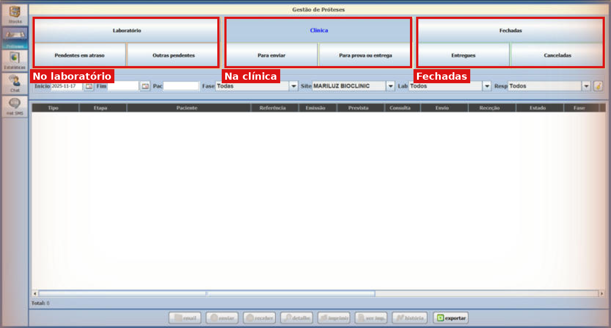{fig-alt="Gestão de próteses: no laboratório, na clínica, fechadas"}

Os mesmos trabalhos aparecem em **Avisos → Próteses** (por enviar, por rececionar, por entregar).

::: {.destaque}
**Em preparação:** o registo de uma prótese nova (onde e quando se cria) ainda está a ser confirmado com a
Tactis. Esta secção vai ser completada.
:::

# 5. Faturas de fornecedores

As faturas e os comprovativos de pagamento dos fornecedores são maioritariamente organizados por um
**automatismo** no Google da clínica (conta geral@). Ele lê o email e algumas pastas do Drive, guarda os PDF e
regista tudo na folha **[Faturas fornecedores – registo](https://docs.google.com/spreadsheets/d/1MsH2aGtVHx9JMY-kvBg2kJUwSecfNRca0Ki7Zz6SqlA/edit)**. A receção usa a folha para registar as
faturas no Novigest e trata do que o automatismo não consegue decidir sozinho.

## Onde estão as pastas

Tudo está no Google Drive da clínica, no disco partilhado **mariluz_bioclinic** (no Drive: *Discos
partilhados → mariluz_bioclinic*). As contas da clínica já têm acesso; não é preciso pedir.

| Pasta ou ficheiro | Para que serve |
|---|---|
| [Faturas fornecedores](https://drive.google.com/drive/folders/1Hg5drof9oeOL8WVFjMRlE6Ab8N22Qy8I) | Pasta principal. O automatismo arquiva aqui as faturas, por ano e mês (*2026 → 11*) |
| [_Entrada](https://drive.google.com/drive/folders/1klbcrJrheZgumjbXYDsG9YRn1fSB6YbS) | **A única pasta onde a receção põe ficheiros**: *Faturas* (faturas em papel digitalizadas) e *Comprovativos* |
| [Faturas de 2026](https://drive.google.com/drive/folders/1j0MtbqWTcyLd0lB6zCY7skUoH9v89p6n) | Faturas já arquivadas, uma subpasta por mês. Só para consultar |
| [Pagamentos](https://drive.google.com/drive/folders/1x-0YpljH-mO_z2gbWtIGBoZtE9gaJ3Q1) | Comprovativos de pagamento já arquivados. Só para consultar |
| [Folha de registo](https://docs.google.com/spreadsheets/d/1MsH2aGtVHx9JMY-kvBg2kJUwSecfNRca0Ki7Zz6SqlA/edit) | Lista de todas as faturas, com o estado no Novigest e o pagamento |

::: {.destaque}
⚠ **Fora da pasta _Entrada, não se cria, move, muda o nome nem apaga nada.** As pastas de cada ano e mês
são organizadas pelo automatismo: um ficheiro mudado à mão deixa de bater com a folha.
:::

## O que entra sozinho

- **Faturas e notas de crédito que chegam por email ao geral@** de fornecedores conhecidos: o PDF é
  guardado no Drive e a fatura aparece na folha. O email fica lido, sai da caixa de entrada e recebe o
  marcador **Faturas**.
- **Débitos diretos** (seguros, telecomunicações, eletricidade, água, renting): contam como pagos
  quando chega a data de vencimento.
- **Comprovativos de transferência do Santander**: ficam ligados à fatura pelo número escrito no
  descritivo da transferência.

::: {.destaque}
**Não é imediato.** O automatismo corre de 10 em 10 minutos. Uma fatura que acabou de chegar por email
ou de ser posta na pasta ainda não está na folha nem foi arquivada: aparece até cerca de 10 minutos depois.
:::

**Onde fica o email depois de tratado.** Quando o automatismo trata um email de fatura ou comprovativo,
o email **sai da caixa de entrada** (não é apagado). Para o encontrar, abrir o marcador **Faturas** ou
**Comprovativos** no Gmail. A exceção são os emails que pedem alguma coisa (ver *Faturas/Ação necessária*
abaixo), que ficam na caixa de entrada.

⚠ **Atenção:** abrir um email antes de o automatismo correr não faz mal, a fatura é registada na mesma.
Mas **não apagar** nem mandar para o spam emails de faturas, porque esses deixam de ser lidos.

## O que a receção faz

::: {.destaque}
⚠ **Registar no Novigest — o mais importante.** Na folha
[Faturas fornecedores – registo](https://docs.google.com/spreadsheets/d/1MsH2aGtVHx9JMY-kvBg2kJUwSecfNRca0Ki7Zz6SqlA/edit), separador **Registo**, as faturas com estado **Por registar** são as
que **faltam no Novigest**. Registar cada uma no Novigest e, logo a seguir, **mudar o estado para
Registada no Novigest**. Uma fatura que fica em "Por registar" não está na contabilidade da clínica.
:::

**Fatura em papel:** digitalizar e pôr o PDF no Drive, em *Faturas fornecedores → _Entrada → Faturas*.

<small>Um comprovativo em papel (caso raro) vai para *_Entrada → Comprovativos*.</small>

::: {.destaque}
⚠ **Uma fatura = um ficheiro.** Nunca digitalizar diferentes faturas e juntá-las no mesmo PDF: o
automatismo só regista uma e as outras perdem-se. Se o scanner juntar tudo, separar antes de pôr na pasta.
:::

- **Não é preciso dar nome ao ficheiro PDF.** O automatismo lê a fatura e muda-lhe o nome sozinho
  (data, fornecedor e número), e tira-a da pasta *_Entrada* depois de a tratar.
- **Digitalizar bem:** o automatismo lê o texto do PDF, por isso uma digitalização má dá erros de leitura
  (número, data ou valor errados). Folha direita, inteira e sem sombras; texto nítido; todas as páginas.
  Sempre que possível, preferir o PDF original enviado pelo fornecedor.

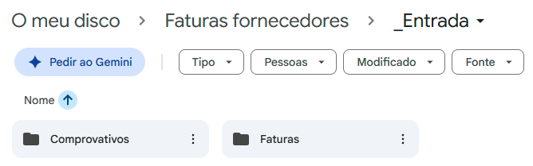{fig-alt="Pasta _Entrada no Drive, com as subpastas Comprovativos e Faturas"}

**Emails com marcadores** (no Gmail do geral@):

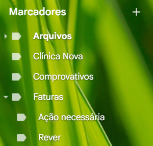{fig-alt="Marcadores no Gmail: Comprovativos, Faturas, Faturas/Ação necessária, Faturas/Rever"}

- **Faturas/Ação necessária:** o email trazia uma fatura ou comprovativo, mas **também pede alguma coisa**
  (por exemplo, devolver uma cópia assinada, confirmar a receção de uma nota de crédito, um pagamento em
  atraso). Fica na caixa de entrada, por ler e com estrela. Ler, tratar ou passar à gestão, e
  **arquivar só depois de tratado**.
- **Faturas/Rever:** remetente desconhecido com uma possível fatura. Abrir: se for fatura de um fornecedor
  da clínica, mudar o marcador para **Faturas**; se não for, tirar o marcador.

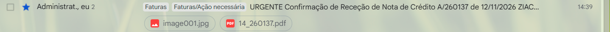{fig-alt="Email na caixa de entrada com estrela e os marcadores Faturas e Faturas/Ação necessária"}

## Verificar se está a correr bem

O automatismo poupa trabalho, mas **não substitui a verificação humana**. Ao registar cada fatura no
Novigest, e sempre que se puser um ficheiro na pasta *_Entrada*:

1. **A fatura apareceu na folha?** Se, 10 a 15 minutos depois, não estiver no Registo, usar
   *Processar agora*. Se continuar sem aparecer, avisar a gestão.
2. **Os dados batem com o PDF?** Abrir o PDF (coluna *PDF*) e comparar **fornecedor, número, data e
   valor**. Se algum estiver errado, **corrigir na folha**: na execução seguinte o ficheiro é renomeado
   com os dados certos.
3. **O fornecedor está identificado?** Se a coluna do fornecedor estiver vazia ou disser "criar no
   Novigest", avisar a gestão antes de registar.
4. **Há linhas em "Rever" ou "Duplicada"?** Abrir o PDF e confirmar. Uma fatura nunca se regista duas vezes
   no Novigest: na dúvida, perguntar à gestão.
5. **A pasta *_Entrada* esvaziou?** Um ficheiro que fica lá mais de 10 a 15 minutos não foi lido (por
   exemplo, porque não é PDF). Avisar a gestão.
6. **Chegou uma fatura em papel que não aparece na folha?** Confirmar que foi digitalizada e posta na pasta.
7. **Ainda há emails a pedir ação ou a rever?** Ver o aviso no separador *A pagar* e os marcadores
   *Faturas/Ação necessária* e *Faturas/Rever*.

::: {.destaque}
Na dúvida, não apagar nada: avisar a gestão.
:::

## A folha

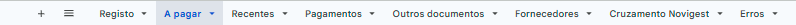{fig-alt="Separadores da folha: Registo, A pagar, Recentes, Pagamentos, Outros documentos, Fornecedores, Cruzamento Novigest, Erros"}

- **Registo:** todas as faturas desde setembro de 2026, com a data de vencimento, o que está pago e o
  comprovativo do pagamento.
- **A pagar:** só o que está em dívida, ordenado pela data de vencimento. As vencidas aparecem a vermelho,
  com os dias em atraso.
- **Recentes:** tudo, do mais recente para o mais antigo.
- Os outros separadores são de apoio e não precisam de ser abertos no dia a dia.

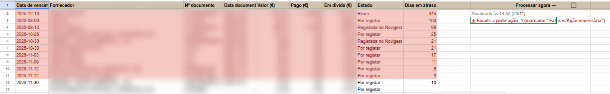{fig-alt="Separador A pagar com a caixa Processar agora e o aviso de emails a pedir ação (fornecedores e valores desfocados)"}

No canto superior direito de **A pagar**:

- **⚠ Emails a pedir ação:** quantos emails com o marcador *Faturas/Ação necessária* ainda estão na caixa
  de entrada. Quando chega a zero, não há pedidos por tratar.
- **Processar agora:** só é preciso quando uma fatura não aparece na folha (ver acima).

## Quando é que o automatismo corre

| Quando | O que acontece |
|---|---|
| De 10 em 10 minutos | Verifica se chegou email novo ou se há ficheiros nas pastas *_Entrada*. Se houver, trata-os |
| Às 8h, 13h e 19h | Volta a ver tudo, mesmo que não haja nada novo (rede de segurança) |
| Caixa **Processar agora** (separador A pagar) | Trata já. Marcar a caixa e esperar 1 a 3 minutos: a caixa desmarca-se sozinha e aparece "Atualizado às…" |

## Documentação em falta (pedidos do contabilista)

Todos os meses o contabilista envia à gestão a lista de documentos que lhe faltam (sobretudo faturas que
aparecem no e-Fatura e que ele não recebeu). A gestão passa essa lista para a folha
**[Documentação em falta](https://docs.google.com/spreadsheets/d/1GP9KVr2OsvWT0b8XJk3WOlGlnGG8S-4I012iGshIP4E/edit)**.
A receção ajuda a encontrar os documentos.

**Como tratar uma linha "Em falta":**

1. Procurar a fatura: no Gmail do geral@ (pesquisar pelo fornecedor ou pelo número), no papel da receção ou
   pedindo-a ao fornecedor.
2. Se foi pedida ao fornecedor e ainda não chegou: mudar o estado para **Pedido à entidade** e escrever
   em *Observações* a quem e quando se pediu.
3. Quando houver PDF: pô-lo em *Faturas fornecedores → _Entrada → Faturas* (ou reencaminhar o email para
   o geral@). O automatismo arquiva-o.
4. Depois de arquivado, abrir o PDF na pasta do mês, copiar o link (*Partilhar → Copiar link*), colar na
   coluna **Link do documento** e mudar o estado para **Disponível na Drive**.

| Estado | Quer dizer |
|---|---|
| Em falta | Ninguém tem o documento |
| Pedido à entidade | Já se pediu ao fornecedor ou ao banco; à espera |
| Disponível na Drive | O documento está no Drive e o link está na linha |

::: {.destaque}
⚠ Na folha só se mexe em **Estado**, **Link do documento** e **Observações**. As outras colunas vêm da
lista do contabilista e não se alteram. Não apagar linhas.
:::

# 6. Caixa e fecho do mês

## Folha de caixa

O registo da caixa (numerário) faz-se **sempre online**, no ficheiro
**[SAIDAS-CAIXA_2026](https://docs.google.com/spreadsheets/d/1osl67rDfC0CG-gA0E0nw33LN3yQMSXMeVBiXmtsCiAw/edit)**,
com um separador por mês.

- **Escrever diretamente nesse ficheiro.** Não descarregar, não fazer cópias em Excel e não enviar por
  email: o contabilista e a gestão veem sempre a versão atual.
- **Uma linha por movimento:** recibos pagos em dinheiro (entrada), depósitos no banco e despesas pagas
  com dinheiro da caixa (saída).
- **Despesa paga em dinheiro = fatura com o NIF da clínica (503 741 086).** Pedir sempre fatura com NIF
  (supermercado, CTT, etc.) e pôr o papel digitalizado em *Faturas fornecedores → _Entrada → Faturas*.
  Uma despesa sem fatura aparece depois na lista de documentação em falta do contabilista.
- No fim do ano a gestão cria o ficheiro do ano seguinte.

## Fecho do mês

No início de cada mês, para o mês anterior:

1. Tirar do Novigest, como até agora, o **SAF-T de faturação** e o **resumo de caixa** do mês.
2. Guardar os dois na pasta
   **[04 Faturação e caixa → 2026](https://drive.google.com/drive/folders/1NXJfJsR7KT3_gor1_Oky1b3DJyt226ZA)**,
   com estes nomes (ano e mês do período):
   - `SAFT_2026-11.xml`
   - `CAIXA_2026-11.xlsx`
3. Confirmar que o separador do mês na folha de caixa está completo.

Já não é preciso enviar estes ficheiros por email ao contabilista: ele tem acesso à pasta.

# 7. Resumo

## O que fazer em cada caso

| Situação | O que fazer |
|---|---|
| Hora a cinzento, sem coluna ou "Férias" | Não marcar: o médico não está |
| Hora a branco | Marcar normalmente |
| Hora a verde (férias do Dr. Ricardo) | Marcar em caso de necessidade, de preferência depois de preenchidas as horas a branco (horário habitual) da Dra. Mariluz |
| Hora a verde (dia de abertura da clínica alterado) | Marcar normalmente, como num dia habitual a branco |
| Consulta autorizada fora de horas | Hora cinzenta → marcar → "fora do horário habitual" |
| Doente não respondeu à SMS de confirmação | Ligar até às 16h; se não atender, SMS de aviso |
| Férias ou ausência de um médico ou de uma assistente | Pedir à gestão por escrito |
| Mudança de horário de um médico | Pedir à gestão por escrito |
| Clínica fecha ou abre fora do habitual | Pedir à gestão por escrito |
| Ligar a um doente para marcar | listas → Lista de Espera |
| Doente desmarcou ou é preciso remarcar | listas → Remarcações |
| Doente ao balcão, sem "Avaliação feita" nem "Avaliação pedida" há menos de um ano | Mostrar o cartão com o código QR; se avaliar, pôr "Avaliação feita" |
| Doente atendido no dia | Ao fim do dia: SMS a pedir avaliação no Google (exceto se tiver "Avaliação feita", ou "Avaliação pedida" há menos de um ano) |
| Doente deixou avaliação no Google | À sexta: mudar a nota no Novigest para "Avaliação feita" |
| Avaliação negativa no Google | Não responder: avisar a gestão |
| Aviso interno com data | Calendário Google Avisos MBC |
| Chegou material | Stocks → Entrada |
| Abriu-se uma embalagem nova, ou produto estragado ou fora de validade | Stocks → Saída |
| Material a acabar | Stocks → Pedidos → Requerer |
| Saber se uma prótese já voltou do laboratório | Próteses (ou Avisos → Próteses) |
| Fatura de fornecedor em papel | Digitalizar (uma fatura = um ficheiro) → Drive, *Faturas fornecedores → _Entrada → Faturas* |
| Email com o marcador Faturas/Ação necessária | Tratar o pedido (ou passar à gestão) e só depois arquivar |
| Email com o marcador Faturas/Rever | Se for fatura de fornecedor: marcador Faturas. Se não: tirar o marcador |
| **Fatura "Por registar" na folha** | **Registar no Novigest e mudar o estado para "Registada no Novigest"** |
| Procurar um email de fatura que saiu da caixa de entrada | Gmail → marcador Faturas (ou Comprovativos) |
| Dados de uma fatura na folha não batem com o PDF | Corrigir na folha (fornecedor, número, data ou valor) |
| Ficheiro continua na pasta _Entrada ou fatura não aparece na folha | Processar agora; se não resolver, avisar a gestão |
| Linha "Em falta" na folha Documentação em falta | Encontrar o documento → _Entrada → colar o link → "Disponível na Drive" |
| Movimento de caixa (recibo em dinheiro, depósito, despesa) | Registar logo na folha de caixa online (SAIDAS-CAIXA do ano) |
| Despesa paga com dinheiro da caixa | Pedir fatura com NIF 503 741 086 → digitalizar → _Entrada → Faturas |
| Início do mês | SAF-T e resumo de caixa do mês anterior → pasta 04 Faturação e caixa, com os nomes SAFT_AAAA-MM e CAIXA_AAAA-MM |

```{=html}
<script>
(function(){
  var d=document.getElementById('data-atualizacao');
  var alvo=document.querySelector('.topo .data');
  if(d&&alvo){alvo.textContent=d.textContent.trim();}
  var hoje=new Date().getDay();
  var el=document.querySelector('.dia[data-d="'+hoje+'"]');
  if(el){el.classList.add('hoje');var b=document.createElement('span');b.className='badge';b.textContent='Hoje';el.querySelector('h4').appendChild(b);}
  document.querySelectorAll('button.copiar').forEach(function(btn){
    btn.addEventListener('click',function(){
      var t=document.getElementById(btn.dataset.alvo);
      var ok=function(){btn.textContent='Copiada';setTimeout(function(){btn.textContent='Copiar mensagem'},1800)};
      var alt=function(){var r=document.createRange();r.selectNodeContents(t);var s=getSelection();s.removeAllRanges();s.addRange(r);btn.textContent='Selecionada: use Ctrl+C'};
      try{navigator.clipboard.writeText(t.textContent).then(ok,alt)}catch(e){alt()}
    });
  });
})();
</script>
```

