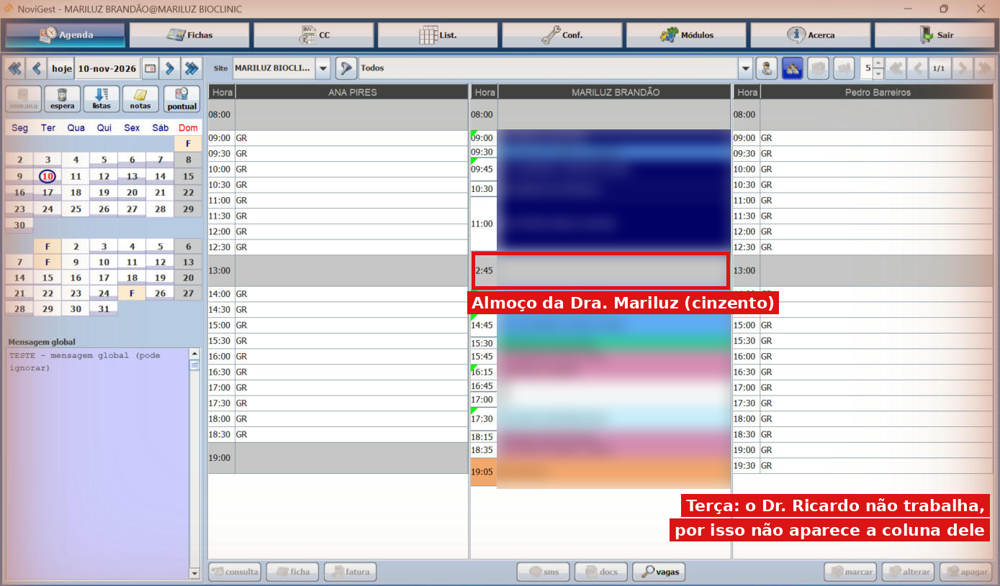
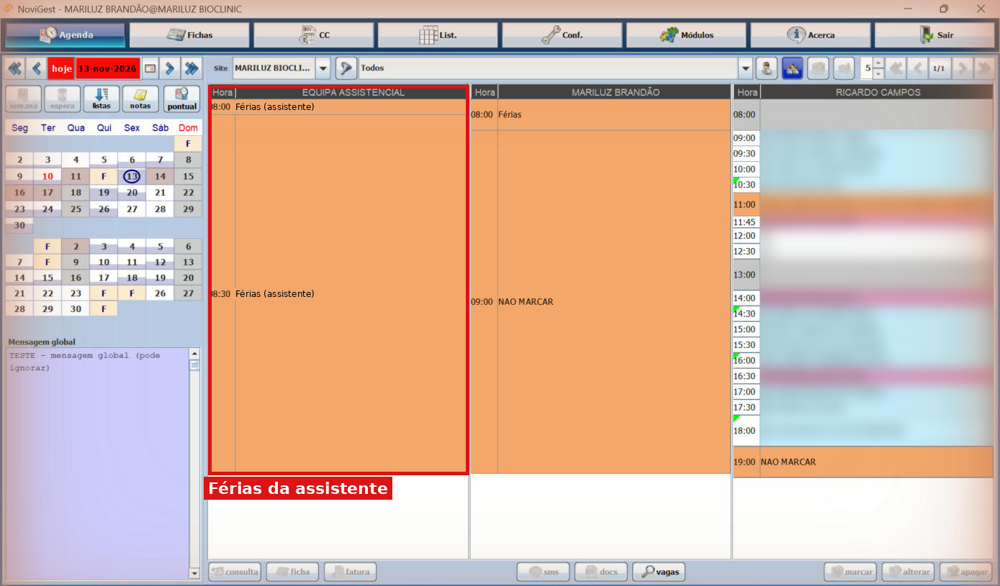

```{=html}
<header class="topo">
  
  <h1 class="titulo">Manual da receção</h1>
  <p class="lead">Uma agenda bem gerida é um dos pilares base do cuidado que queremos prestar.</p>
  <p class="meta">Agenda Novigest · atualizado a <span class="data"></span></p>
</header>
```

[]{#data-atualizacao .escondido}

::: {.nota}
**Para que serve.** Guia rápido para a receção: o que se vê na agenda do Novigest e o que fazer em
cada caso. Horários, férias, ausências e dias de encerramento são registados pela gestão (Salomé).
A equipa pede por escrito e depois vê o resultado na agenda.
:::

## As regras da agenda

```{=html}
<ol class="regras">
  <li><span class="num">1</span><div><b>A agenda mostra sozinha quando se marca.</b><span>Já não se escreve "NÃO MARCAR" nem "ENCERRADA" na agenda.</span></div></li>
  <li><span class="num">2</span><div><b>Branco marca-se. Cinzento não.</b><span>O cinzento é fora do horário. Só se marca com autorização do médico ou da gestão.</span></div></li>
  <li><span class="num">3</span><div><b>Verde: depende do motivo.</b><span>Nas férias do Dr. Ricardo, em caso de necessidade, de preferência depois de preenchidas as horas a branco da Dra. Mariluz. Num dia de abertura alterado (ex.: quarta em vez de terça), marca-se normalmente.</span></div></li>
  <li><span class="num">4</span><div><b>Mudanças de horário pedem-se à gestão.</b><span>Férias, ausências e dias diferentes. Até aparecerem na agenda, não se marca nesses dias ou horas.</span></div></li>
  <li><span class="num">5</span><div><b>Na coluna EQUIPA ASSISTENCIAL nunca se marca.</b><span>Só aparece quando alguém da equipa está ausente.</span></div></li>
</ol>
```

## Todos os dias

```{=html}
<div class="tarefas">
  <div class="tarefa t-ler"><small>1</small>Abrir <b>listas</b> e tratar a Lista de espera e as Remarcações pendentes.</div>
  <div class="tarefa t-ligar"><small>2</small>Devolver todas as chamadas.</div>
  <div class="tarefa t-enviar"><small>3</small>Confirmar as consultas, segundo o <a href="#confirmação-de-consultas">procedimento de confirmação</a>.</div>
</div>
```

## Horários dos médicos

```{=html}
<div class="medicos">
  <div class="cartao">
    <h3>Dr. Ricardo Campos</h3>
    <p><b>Segunda e sexta:</b> 9h–13h · 14h–19h</p>
    <p><b>Sábado</b>, de 15 em 15 dias: 9h–13h</p>
  </div>
  <div class="cartao">
    <h3>Dra. Mariluz Brandão</h3>
    <p><b>Segunda:</b> 14h–19h <span class="suave">(de manhã só falando com ela)</span></p>
    <p><b>Terça e quinta:</b> 9h–12h30 · 14h–19h</p>
    <p><b>Sexta:</b> 9h30–12h30 · 14h–17h30</p>
    <p><b>Sábado:</b> só quando o Dr. Ricardo está de férias</p>
  </div>
</div>
```

A clínica fecha à quarta e ao domingo. Abre ao sábado de 15 em 15 dias, das 9h às 13h.
Os sábados em que está fechada aparecem com **F** no calendário.

::: {.destaque}
**Dois gabinetes ao mesmo tempo.** O objetivo é ter os dois gabinetes a funcionar ao mesmo tempo nas
horas em que estão duas assistentes presentes. Nessas horas, sempre que possível, preencher as agendas
dos dois médicos em simultâneo.
:::

A Ana Pires e o Pedro Barreiros não têm horário fixo: só aparecem na agenda nos dias combinados com a
gestão ou quando já têm marcações. O Dr. Renato Conti já não trabalha na clínica.

## Como ler a agenda

```{=html}
<div class="legenda">
  <div class="item"><span class="cor branco"></span><div><b>Branco ("GR")</b><span>Horário habitual do médico. Marca-se.</span></div></div>
  <div class="item"><span class="cor verde"></span><div><b>Verde claro</b><span>Horas extra só nesse dia. Como se marca depende do motivo (ver abaixo).</span></div></div>
  <div class="item"><span class="cor cinzento"></span><div><b>Cinzento</b><span>Fora do horário. Não se marca, salvo autorização.</span></div></div>
  <div class="item"><span class="cor laranja"></span><div><b>"Férias" a laranja</b><span>Médico ausente. Não se marca.</span></div></div>
  <div class="item"><span class="cor letra">F</span><div><b>F no calendário</b><span>Clínica fechada.</span></div></div>
  <div class="item"><span class="cor laranja"></span><div><b>Coluna EQUIPA ASSISTENCIAL</b><span>Alguém da equipa está ausente. Nunca se marca aqui.</span></div></div>
</div>
```

Se um médico não tem coluna num dia, não trabalha nesse dia. A coluna só aparece se lá houver uma
marcação antiga.

**Exemplo 1.** Numa terça-feira, o Dr. Ricardo não aparece e o almoço da Dra. Mariluz está a cinzento.

{fig-alt="Agenda de uma terça-feira: o Dr. Ricardo não aparece e o almoço da Dra. Mariluz está a cinzento"}

**Exemplo 2.** Numa sexta-feira, a Dra. Mariluz só tem branco das 9h30 às 12h30 e das 14h às 17h30.

{fig-alt="Agenda de uma sexta-feira: períodos a cinzento da Dra. Mariluz"}

### Horas a verde: depende do motivo

As horas a verde são horas que não fazem parte do horário habitual do médico. Aparecem por dois motivos,
e marca-se de forma diferente em cada um:

```{=html}
<div class="legenda">
  <div class="item"><span class="cor verde"></span><div><b>Férias do Dr. Ricardo</b><span>A Dra. Mariluz assume as horas dele que ficam disponíveis. Marcar em caso de necessidade, de preferência depois de preenchidas as horas a branco (horário habitual) dela.</span></div></div>
  <div class="item"><span class="cor verde"></span><div><b>Dia de abertura alterado</b><span>A clínica abre num dia em que normalmente fecha, em troca de outro (ex.: abre à quarta e fecha à terça). Marcar normalmente, como num dia habitual a branco.</span></div></div>
</div>
```


**Exemplo 3.** A Dra. Mariluz faz o horário do Dr. Ricardo, que está de férias. As horas extra aparecem a verde.

{fig-alt="Horas pontuais a verde e horário habitual a branco na coluna da Dra. Mariluz"}

## Confirmação de consultas

O objetivo é ter a agenda cheia e saber quem vem. A receção tem duas tarefas: enviar ou agendar as SMS
de confirmação, e ligar a quem não respondeu.

```{=html}
<ol class="regras">
  <li><span class="num">1</span><div><b>Não responder não é faltar.</b><span>Muita gente não responde e aparece na mesma. Nunca desmarcar alguém só porque não respondeu.</span></div></li>
  <li><span class="num">2</span><div><b>Uma vaga só se liberta se houver quem a ocupe.</b><span>Sem ninguém na Lista de espera, a consulta fica marcada.</span></div></li>
  <li><span class="num">3</span><div><b>A lista de chamadas está no Novigest.</b><span>Ligar a todas as consultas que ainda estão em "A Confirmar".</span></div></li>
  <li><span class="num">4</span><div><b>Chamadas feitas até às 16h.</b><span>Assim o doente ainda tem tempo de responder até às 19h.</span></div></li>
  <li><span class="num">5</span><div><b>Lembretes só depois das 19h.</b><span>Vão só para quem confirmou, por isso agendam-se ao fecho.</span></div></li>
</ol>

<h3 class="sub3">Tarefas de cada dia</h3>
<div class="dias">
  <div class="dia" data-d="1"><h4>Segunda</h4>
    <div class="tarefa t-ler"><small>1. Ao abrir</small>Ler as SMS que chegaram no fim de semana</div>
    <div class="tarefa t-enviar"><small>2. De manhã, enviar</small>SMS de confirmação para as <b>consultas de quinta</b></div>
    <div class="tarefa t-ligar"><small>3. Até às 16h, ligar a quem não confirmou</small><b>consultas de terça</b> em "A Confirmar"</div></div>
  <div class="dia" data-d="2"><h4>Terça</h4>
    <div class="tarefa t-ligar"><small>1. Até às 16h, ligar a quem não confirmou</small><b>consultas de quinta</b> em "A Confirmar"</div>
    <div class="tarefa t-enviar"><small>2. Depois das 19h, agendar para quarta</small>SMS de confirmação para as <b>consultas de sexta</b><br>Lembrete para as <b>consultas de quinta</b> já confirmadas</div></div>
  <div class="dia" data-d="4"><h4>Quinta</h4>
    <div class="tarefa t-ler"><small>1. Ao abrir</small>Ler as SMS que chegaram na quarta</div>
    <div class="tarefa t-enviar"><small>2. De manhã, enviar</small>SMS de confirmação para as <b>consultas de segunda e sábado</b></div>
    <div class="tarefa t-ligar"><small>3. Até às 16h, ligar a quem não confirmou</small><b>consultas de sexta</b> em "A Confirmar"</div></div>
  <div class="dia" data-d="5"><h4>Sexta</h4>
    <div class="tarefa t-ligar"><small>1. Até às 16h, ligar a quem não confirmou</small><b>consultas de segunda e sábado</b> em "A Confirmar"</div>
    <div class="tarefa t-enviar"><small>2. Depois das 19h, agendar para domingo</small>SMS de confirmação para as <b>consultas de terça</b><br>Lembrete para as <b>consultas de segunda</b> já confirmadas</div></div>
</div>
<p class="suave">Quarta e domingo: clínica fechada. Saem as SMS agendadas na véspera. Sábado: sem tarefas fixas.</p>

<h3 class="sub3">O que fazer em cada chamada</h3>
<div class="fluxo">
  <div class="passo">Ligar ao doente que está em "A Confirmar"</div>
  <div class="seta"></div>
  <div class="passo q">Atendeu?</div>
  <div class="seta"></div>
  <div class="ramos">
    <div class="ramo">
      <span class="pill sim">Sim</span>
      <div class="passo">Vem: mudar para <b>Confirmada</b>.<br>Não vem: desmarcar e propor outra data. Se não marcar já, vai para <b>Remarcações</b>.</div>
    </div>
    <div class="ramo">
      <span class="pill nao">Não</span>
      <div class="passo">Enviar logo a <b>SMS de aviso</b> (mensagem 2)</div>
      <div class="seta"></div>
      <div class="passo q">Respondeu até às 19h?</div>
      <div class="seta"></div>
      <div class="ramos interno">
        <div class="ramo"><span class="pill sim">Sim</span><div class="passo">Tratar como "Atendeu"</div></div>
        <div class="ramo"><span class="pill nao">Não</span><div class="passo">Há alguém na <b>Lista de espera</b>?<br>Sim: libertar a vaga e ligar a essa pessoa.<br>Não: a consulta <b>fica marcada</b>.</div></div>
      </div>
    </div>
  </div>
</div>

<h3 class="sub3">Estados no Novigest</h3>
<div class="estados">
  <div><b>A Confirmar</b><span>A SMS de confirmação já saiu e o doente ainda não respondeu. Usar só para isto.</span></div>
  <div><b>Confirmada</b><span>O doente respondeu SIM, por SMS ou ao telefone.</span></div>
  <div><b>Remarcações</b><span>O doente não pode vir e ainda não escolheu nova data.</span></div>
</div>

<h3 class="sub3">As mensagens</h3>
<div class="msgs">
  <article class="msg">
    <header><h4>1. Confirmação</h4><span class="quem auto">Receção envia ou agenda</span></header>
    <div class="sms" id="m1">Mariluz Bioclinic: tem consulta a [dia] às [hora]. Por favor confirme respondendo SIM, ou NÃO se precisar de desmarcar.</div>
    <button type="button" class="copiar" data-alvo="m1">Copiar mensagem</button>
    <p>Sai 2 a 4 dias antes da consulta. Depois de enviar, pôr as consultas em "A Confirmar". Quem responde SIM passa a "Confirmada".</p>
  </article>
  <article class="msg">
    <header><h4>2. Aviso, quando não atende</h4><span class="quem voce">Envia a receção</span></header>
    <div class="sms" id="m2">Não conseguimos confirmar a sua consulta de [dia] às [hora]. Se não recebermos resposta até às 19h de hoje, a vaga poderá ser atribuída a outro doente.</div>
    <button type="button" class="copiar" data-alvo="m2">Copiar mensagem</button>
    <p>Enviar só depois de ligar e o doente não atender.</p>
  </article>
  <article class="msg">
    <header><h4>3. Lembrete da véspera</h4><span class="quem auto">Receção agenda</span></header>
    <div class="sms" id="m3">Mariluz Bioclinic: lembramos a sua consulta amanhã, [dia], às [hora]. Se não puder comparecer, avise-nos por favor.</div>
    <button type="button" class="copiar" data-alvo="m3">Copiar mensagem</button>
    <p>Só para consultas de segunda e quinta já confirmadas. Agendado na terça e na sexta, depois das 19h.</p>
  </article>
</div>
```

::: {.nota}
**Consulta marcada em cima da hora?** Se a consulta é marcada depois de a SMS de confirmação já ter
saído, confirmá-la logo ao telefone ou ao balcão e pô-la em "Confirmada".
:::

## Marcar fora do horário

Só se marca numa hora cinzenta quando o médico ou a gestão autorizam, por exemplo um doente às 19h.

1. Clicar na hora cinzenta, na coluna do médico.
2. Clicar em **marcar** (em baixo, à direita).
3. Escolher **"Efectuar marcação fora do horário habitual"** e confirmar. Depois marca-se como de costume.

{fig-alt="Marcar fora do horário habitual: hora cinzenta, marcar, escolher a opção"}

## Pedidos à gestão

Tudo o que muda os horários é feito pela gestão. Pede-se por escrito (email ou mensagem) à Salomé:

- **Férias ou ausência de um médico ou de uma assistente:** nome, data de início e de fim, motivo.
- **Médico muda o horário num dia** (entra mais tarde, sai mais cedo, almoço noutra hora) **ou vem num dia extra:** médico, dia e horas.
- **Clínica fechada ou aberta num dia fora do habitual:** o dia.

::: {.destaque}
Enquanto o pedido não aparecer na agenda, não marcar doentes nesses dias ou horas.
:::

Depois de registado, vê-se assim na agenda:

- **Férias de um médico:** "Férias" a laranja na coluna dele.
- **Férias de uma assistente:** aparece a coluna EQUIPA ASSISTENCIAL nesses dias, com o nome de quem está fora.
- **Horas que o médico deixa de fazer:** cinzento. **Horas extra:** verde.
- **Clínica fechada:** F no calendário.

{fig-alt="Agenda com as férias do médico a laranja"}

{fig-alt="Coluna EQUIPA ASSISTENCIAL com as férias de uma assistente"}

Se já houver doentes marcados nos dias ou horas que saem, pô-los nas
[Remarcações](#consultas-a-remarcar-remarcações). As marcações não desaparecem sozinhas.

## Lembretes para ligar a doentes: Lista de espera

Os lembretes do tipo "ligar para agendar limpeza" ou "passaram 6 meses, avisar" vão para a
**Lista de espera**. Deixam de ser marcações "A confirmar" às 9h na coluna de um médico.

**Para acrescentar um doente:**

1. Clicar em **listas** (em cima, à esquerda).
2. No separador **Lista de Espera**, clicar em **inserir**.
3. Procurar o doente pelo nome, código ou NIF.
4. Em **Validade**, pôr a data até à qual o doente deve ser marcado.
5. Escolher o **Médico**. Se o doente só puder em certos dias, tirar o visto aos outros em **Restrições**.
6. Clicar em **ok**.
7. Com a entrada selecionada na lista, escrever em **Notas** o que é preciso fazer, por exemplo "limpeza + controlo" ou "cheque-dentista de grávida".

{fig-alt="Lista de espera: botão listas, inserir e total por tratar"}

{fig-alt="Adição de entrada na lista de espera: doente, validade, médico, ok"}

**Quando o doente fica marcado:** selecioná-lo na lista, usar **vagas** para encontrar uma hora livre e,
depois de marcado, **eliminar** a entrada.

O número de doentes por tratar aparece à esquerda, em "Total de pacientes em lista de espera".

## Consultas a remarcar: Remarcações

Quando um doente desmarca e é preciso voltar a marcar, ou quando uma ausência do médico obriga a mudar
consultas, o doente vai para as **Remarcações**.

1. Clicar em **listas** e abrir o separador **Remarcações**.
2. Clicar em **inserir** e escrever o código do doente (ou procurar pelo nome).
3. Em **Data**, pôr a data da consulta que é preciso mudar e escolher o **Médico**.
4. Na caixa grande, escrever o motivo e clicar em **ok**.
5. Ao selecionar a entrada, em baixo aparecem as **marcações futuras** do doente. É aí que se vê a consulta original.
6. Depois de remarcado, pôr o visto em **Tratado**.

{fig-alt="Separador Remarcações com o botão inserir e o total pendente"}

O número por tratar aparece à esquerda, em "Total de remarcações pendentes".

## Resumo: o que fazer em cada caso

| Situação | O que fazer |
|---|---|
| Hora a cinzento, sem coluna ou "Férias" | Não marcar: o médico não está |
| Hora a branco | Marcar normalmente |
| Hora a verde (férias do Dr. Ricardo) | Marcar em caso de necessidade, de preferência depois de preenchidas as horas a branco (horário habitual) da Dra. Mariluz |
| Hora a verde (dia de abertura da clínica alterado) | Marcar normalmente, como num dia habitual a branco |
| Consulta autorizada fora de horas | Hora cinzenta → marcar → "fora do horário habitual" |
| Doente não respondeu à SMS de confirmação | Ligar até às 16h; se não atender, SMS de aviso |
| Férias ou ausência de um médico ou de uma assistente | Pedir à gestão por escrito |
| Mudança de horário de um médico | Pedir à gestão por escrito |
| Clínica fecha ou abre fora do habitual | Pedir à gestão por escrito |
| Ligar a um doente para marcar | listas → Lista de Espera |
| Doente desmarcou ou é preciso remarcar | listas → Remarcações |
| Aviso interno com data | A definir |

```{=html}
<script>
(function(){
  var d=document.getElementById('data-atualizacao');
  var alvo=document.querySelector('.topo .data');
  if(d&&alvo){alvo.textContent=d.textContent.trim();}
  var hoje=new Date().getDay();
  var el=document.querySelector('.dia[data-d="'+hoje+'"]');
  if(el){el.classList.add('hoje');var b=document.createElement('span');b.className='badge';b.textContent='Hoje';el.querySelector('h4').appendChild(b);}
  document.querySelectorAll('button.copiar').forEach(function(btn){
    btn.addEventListener('click',function(){
      var t=document.getElementById(btn.dataset.alvo);
      var ok=function(){btn.textContent='Copiada';setTimeout(function(){btn.textContent='Copiar mensagem'},1800)};
      var alt=function(){var r=document.createRange();r.selectNodeContents(t);var s=getSelection();s.removeAllRanges();s.addRange(r);btn.textContent='Selecionada: use Ctrl+C'};
      try{navigator.clipboard.writeText(t.textContent).then(ok,alt)}catch(e){alt()}
    });
  });
})();
</script>
```
